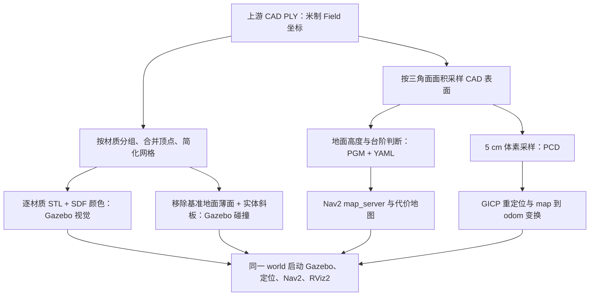

# RMUC 2027 UC 地图移植过程与启动说明

本文重点记录如何把 [RMUC_2027map_unity](https://github.com/diaofenyuan/RMUC_2027map_unity) 接入已有 ROS 2 工作区 `/home/c/ros_ws`。移植涉及三套资源：Gazebo 的三维视觉与碰撞、Nav2 的二维占用地图、GICP 的重定位点云。三者必须使用同一套米制坐标，机器人才能在 Gazebo 里运动、在 RViz2 中正确定位并完成导航。

本机环境为 Ubuntu 22.04、ROS 2 Humble、Ignition Gazebo Fortress 6、RViz2、Nav2。以下路径和操作以当前本地工程为基础；原项目说明保留在 [仿真仓库 README](src/rmu_gazebo_simulator/README.md) 和 [导航仓库 README](src/pb2025_sentry_nav/README.md)。

## 1. 移植思路与数据流

本次直接使用上游提供的 CAD PLY，不需要启动 Unity 再导出场景。



先固定坐标和场地几何，再生成地图、接入定位，最后处理渲染、底盘和启动兼容问题。仅替换 Gazebo 模型文件，不会自动替换 RViz2 地图和定位点云。

## 2. 获取上游资源并确认坐标

### 2.1 固定资源版本

本次使用的上游提交为 `f55769a94578362f84e7cd25fe0b3f5fc5e11a8a`，核心输入为：

| 上游文件 | 用途 |
| --- | --- |
| `Project/Assets/Field/field_geometry_m.ply` | 三角网格、顶点与面颜色，作为转换输入 |
| `Project/Assets/Field/field_geometry.json` | 单位、原始网格规模和坐标元数据 |
| `reference/field.json` | 场地参考信息，随模型保存 |
| `README.md` | 上游说明和资产许可边界，复制为 `UPSTREAM_README.md` |

在已安装 Git LFS 的环境中，可按以下方式准备上游资源。目标目录应尚不存在：

```bash
cd /tmp
git clone https://github.com/diaofenyuan/RMUC_2027map_unity.git RMUC_2027map_unity
cd RMUC_2027map_unity
git checkout f55769a94578362f84e7cd25fe0b3f5fc5e11a8a
git lfs pull
sha256sum Project/Assets/Field/field_geometry_m.ply
```

预期 SHA-256：

```text
794d1736e76f3092f08aa268097fc1cfa3e39cd4d6a034b86b19f72229681076
```

PLY 约 189 MiB，包含 `7,048,495` 个顶点、`7,071,310` 个三角面。如果下载到的只是几行 Git LFS 指针文本，转换无法进行。导入脚本也会检查上述哈希，防止混用资源版本。

### 2.2 确认坐标后再转换

虽然仓库用于 Unity，但 `field_geometry_m.ply` 已经是米制 Field 坐标：X/Y 保持原值，Z 向上。名义比赛区域为 `28 × 15 m`，原始几何边界约为：

```text
x:  0.0000 ～ 28.0000 m
y: -0.5016 ～ 15.5016 m
z: -0.3010 ～  3.4977 m
```

因此本次没有交换 Y/Z、没有重复乘毫米到米的比例，也没有把模型平移到中心。Gazebo 世界中的模型位姿设为零，地图原点设为 `[0,0,0]`，PCD 保留相同绝对坐标。超出名义比赛区域的几何仍保留在三维场地中，二维地图只覆盖 `x∈[0,28)`、`y∈[0,15)`。

基准地面以中线 `y=7.5`、`z=0` 为最高处，向两侧倾斜 `1.5°`。转换脚本使用以下地面高度模型：

```python
ground_z = -abs(y - 7.5) * tan(radians(1.5))
```

这个高度同时用于碰撞地面、导航地面判断和初始定位检查。场地有负 Z，不能把所有地面强行压到 `z=0`。

## 3. 将 CAD 网格转换为 Gazebo 模型

实现文件：[import_rmuc2027.py](src/rmu_gazebo_simulator/tools/import_rmuc2027.py)、[export_field_visuals.py](src/rmu_gazebo_simulator/tools/export_field_visuals.py)。

### 3.1 解析 PLY 并减小网格规模

`read_ply()` 按当前上游二进制格式读取：顶点为 little-endian float32 XYZ；每个面包含顶点数量、三个 int32 索引和 RGB 颜色。脚本检查所有面都是三角形。

为避免直接加载七百多万个三角面，`main()` 对每种 RGB 材质分别执行：

1. 提取该颜色的面及其引用顶点。
2. 将顶点坐标四舍五入到 1 cm 网格，并合并重合顶点。
3. 删除退化面和重复面。
4. 调用 `fast_simplification.simplify()`，目标面数约为合并后面数的 25%；小材质组按脚本下限处理。
5. 合并输出汇总 `rmuc_2027.obj` 和 `rmuc_2027.mtl`。

最终视觉网格为 `157,823` 个三角面。逐材质简化能保留场地颜色分组，降低渲染与碰撞计算量；网格已经近似化，不能把转换结果当成毫米级 CAD 真值。

### 3.2 处理 Fortress 材质显示

本机测试时，汇总 OBJ/MTL 和尝试过的 DAE 仍显示为白色。因此最终没有依赖导入器恢复颜色，而是由 `export_field_visuals.py`：

1. 读取 OBJ 中的 `usemtl` 分组以及 MTL 中的 `Kd` 颜色。
2. 将每一组面写为一个二进制 STL，并计算法向。
3. 为每组创建独立 SDF `<visual>`，显式设置 `ambient`、`diffuse`、`specular`。

最终模型有 39 个视觉分组，结构类似：

```xml
<visual name="cad_1">
  <geometry>
    <mesh><uri>model://rmuc_2027/meshes/cad_1.stl</uri></mesh>
  </geometry>
  <material>
    <ambient>0 0 1 1</ambient>
    <diffuse>0 0 1 1</diffuse>
    <specular>0.03 0.03 0.03 1</specular>
  </material>
</visual>
```

STL 本身不保存颜色，颜色来自 SDF。汇总 OBJ/MTL 保留为转换中间资源，最终 Gazebo 视觉引用 `cad_*.stl`。

### 3.3 独立处理碰撞地面

只使用 CAD 薄三角面作为地面时，仿真中出现接触不稳定。加入实体斜板后，又需要去掉重叠的基准地面面片，避免重复接触。

当前处理方式是：在简化网格中，若一个三角形的三个顶点距离上述基准地面都小于 `0.025 m`，则从碰撞网格中去掉该面。其余场地障碍、坡道和台阶仍写入 `rmuc_2027_collision.stl`，共 `154,838` 个三角面。视觉网格不执行这项删除。

随后在 `model.sdf` 中加入两块厚 `0.08 m` 的实体斜板：

| 碰撞体 | pose：x y z roll pitch yaw | box size：x y z |
| --- | --- | --- |
| `south_ground` | `14 3.5 -0.144783 0.02617994 0 0` | `28 8.005 0.08` |
| `north_ground` | `14 11.5 -0.144783 -0.02617994 0 0` | `28 8.005 0.08` |

这两块斜板的上表面近似贴合双侧地面。三个碰撞体的 ODE 摩擦参数均设为 `mu=0.1`、`mu2=0.1`，用于当前通过车体受力驱动的全向底盘。更换底盘动力学模型时，需要重新评估这些接触参数。

### 3.4 建立模型、世界文件和资源搜索路径

新增模型目录：

```text
src/rmu_gazebo_simulator/rmu_gazebo_simulator/resource/models/rmuc_2027/
├── model.config                 # 模型名称、版本、SDF 入口
├── model.sdf                    # 静态场地、视觉、碰撞和实体地面
├── meshes/
│   ├── cad_*.stl                # 最终逐材质视觉网格
│   ├── rmuc_2027.obj / .mtl     # 汇总中间资源
│   └── rmuc_2027_collision.stl  # 障碍碰撞网格
├── source.json                  # 提交、哈希、网格规模和坐标说明
├── field_geometry.json
├── field_reference.json
└── UPSTREAM_README.md
```

手工建立 `model.config` 和 `model.sdf` 骨架后，转换脚本负责更新视觉与网格资源。模型设为 `<static>true</static>`。

新增 [rmuc_2027_world.sdf](src/rmu_gazebo_simulator/rmu_gazebo_simulator/resource/worlds/rmuc_2027_world.sdf)，沿用现有世界的 Physics、SceneBroadcaster、UserCommands、Sensors、IMU 和灯光配置，引用 `model://rmuc_2027`，模型位姿为零。世界名称继续使用 `default`，使已有 `/world/default/...` 传感器桥接和服务路径能够继续工作。

原仿真包的环境 hook 已把安装后的 `resource/models` 和 `resource/worlds` 加入 `IGN_GAZEBO_RESOURCE_PATH` 等搜索路径，因此无需硬编码外部模型目录。新增资源后编译仿真包，再 source `install/setup.bash`，让模型 URI 和安装路径生效。

## 4. 从同一 CAD 生成 Nav2 栅格与定位点云

实现位于 `import_rmuc2027.py` 的 `generate_navigation()`。此步骤使用原始 CAD 网格采样，避免导航资源受到视觉简化的额外影响。上游示意图只作参考，没有直接作为导航地图。

### 4.1 采样 CAD 表面

计算每个三角面的面积，以面积为概率权重选择 `3,500,000` 个面，再用三角形内均匀重心采样生成表面点。随机种子固定为 `2027`，便于重复生成。

随后保留二维名义场地范围内的点。每个点映射到：

```python
ix = floor(x / 0.05)
iy = floor(y / 0.05)
```

### 4.2 估计地面高度与标记障碍

每个栅格的初始高度取基准双斜面高度，再从采样点更新可作为地面的表面。实际阈值如下：

| 判断 | 当前实现 |
| --- | --- |
| 近水平表面 | `abs(normal_z) > 0.90`，兼容 CAD 正反面法向 |
| 地面候选高度 | 高于基准地面 `-0.03 m`，低于基准地面 `+0.55 m` |
| 每格表面高度 | 对候选点取最大高度，再做 `3×3` 中值滤波 |
| 车体高度障碍 | 点高于该格表面 `0.12 m`，且低于表面 `0.65 m` |
| 不可直接跨越的高度突变 | 相邻栅格高度差大于 `0.075 m`，两侧均标占用 |
| 补小缝隙 | 对占用栅格做 `3×3` 二值闭运算 |
| 场地边界 | 最外圈标为占用 |

这些是当前机器人和场地的经验阈值。它们用于区分连续地面与突变台阶，不保证所有层叠几何都能被二维地图准确表达。

一个实际排查结果是：从出生点直行到 `(4,2)` 会遇到约 `x=3.5 m` 的 CAD 台阶，车体能收到非零指令却被物理碰撞挡住。最初仅识别正向法向时，这段边界标记不完整；改为 `abs(normal_z)` 后重新生成栅格。不能仅凭“路径规划成功”判断底盘一定能通过。

### 4.3 输出 PGM 和地图 YAML

占用像素写 `0`，自由像素写 `254`。保存 PGM 前上下翻转数组，因为图像行从顶部开始，而地图 Y 从下向上增加。输出为：

```text
src/pb2025_sentry_nav/pb2025_nav_bringup/map/simulation/rmuc_2027.pgm
src/pb2025_sentry_nav/pb2025_nav_bringup/map/simulation/rmuc_2027.yaml
```

YAML 是手工配套配置，内容为：

```yaml
image: rmuc_2027.pgm
mode: trinary
resolution: 0.05
origin: [0.0, 0.0, 0.0]
negate: 0
occupied_thresh: 0.65
free_thresh: 0.25
```

地图宽 `560`、高 `300`，对应 `28×15 m`。不要再给地图加中心平移，否则会与 Gazebo 模型和 PCD 错位。

### 4.4 输出 GICP 的 PCD

对同一批范围内的表面点按 XYZ 的 `0.05 m` 三维体素去重，每格保留一个点，输出 binary PCD，字段为 float32 `x y z`，共 `532,456` 点：

```text
src/pb2025_sentry_nav/pb2025_nav_bringup/pcd/simulation/rmuc_2027.pcd
```

PCD 保留 CAD 的 `map` 绝对坐标，不减出生点、不转换为雷达初始坐标。导航仓库原本忽略 `*.pcd`，因此在 `.gitignore` 中专门增加例外：

```gitignore
!pb2025_nav_bringup/pcd/simulation/rmuc_2027.pcd
```

## 5. 接入定位，统一 Gazebo、map 与 odom

### 5.1 让 GICP 明确区分点云坐标来源

修改 [small_gicp_relocalization.cpp](src/pb2025_sentry_nav/small_gicp_relocalization/src/small_gicp_relocalization.cpp)。旧逻辑假设先验地图来自 `lidar_odom`，加载后会乘一次雷达安装变换；2027 CAD 点云已经在 `map` 中，继续走旧分支会重复变换。

新增 `prior_pcd_frame` 参数：

```text
prior_pcd_frame = map        → 直接使用 PCD 坐标
prior_pcd_frame = lidar_odom → 沿用原先雷达安装变换（默认，兼容旧地图）
```

同时暴露最大迭代次数和收敛阈值参数，让 2027 可独立配置。GICP 将实时 `registered_scan` 与先验 PCD 配准，发布 `map → odom`；单次不收敛时保留上次有效变换。

### 5.2 同步出生点与定位初值

在仿真包 `config/gz_world.yaml` 中增加并默认选择 `rmuc_2027`：

```yaml
world: rmuc_2027
robots:
  rmuc_2027:
    - name: red_standard_robot1
      color: red
      x_pose: "3.0"
      y_pose: "2.0"
      z_pose: "0.08"
      yaw: "0.0"
```

机器人生成后会落到斜面上，因此生成高度 `0.08` 不等于落稳后的地面高度。独立导航参数中设置：

```yaml
small_gicp_relocalization:
  ros__parameters:
    prior_pcd_frame: map
    init_pose: [3.0, 2.0, -0.144, 0.02617994, 0.0, 0.0]
    max_iterations: 40
    translation_epsilon: 0.005
    rotation_epsilon: 0.0034906585
```

`init_pose` 的六项为 `[x,y,z,roll,pitch,yaw]`，在当前实现中用于初始化 GICP 的目标到源点云变换，即发布的 `map → odom` 初值。它与出生位置、斜面姿态和里程计初始参考有关，不能直接复制仿真生成高度。更改出生点后，要对照 TF、真实位姿与点云叠合重新检查初值。

### 5.3 独立保存 2027 控制参数

从原 `nav2_params.yaml` 复制为 `nav2_params_rmuc_2027.yaml`，只让 2027 入口选择它。当前差异包括：

| 参数 | 原配置 | 2027 配置 |
| --- | --- | --- |
| 初始自旋 `init_spin_speed` | `3.14` | `0.0` |
| 平移 PID `kp / ki / kd` | `3.0 / 0.1 / 0.3` | `1.0 / 0.0 / 0.05` |
| 接近目标最低速度 | `0.5` | `0.1` |
| 平移输出上下限 | `±2.5` | `±0.6` |

2027 生成机器人 SDF 时额外注入底盘插件 `linear_velocity_p=500`、`linear_velocity_i=100`。为此在 `MecanumDrive2.cc` 中新增可读取的参数；未配置的旧场地仍使用默认比例和零积分。插件同时增加暂停及非正时间步保护。

这里区分 Nav2 的路径跟踪参数与 Gazebo 底盘速度闭环参数。前者决定导航速度指令，后者决定用多大车体受力跟随速度；改一个不能替代另一个。

## 6. 接入启动链路和 RViz2

### 6.1 把 world 参数传到场地和出生点

修改仿真包的三个 launch 文件：

| 文件 | 修改方式与原因 |
| --- | --- |
| `bringup_sim.launch.py` | 声明 `world` 参数，以运行时参数拼接 `<world>_world.sdf`；将同一 world 传给机器人生成入口；2027 选择专用 GUI 配置 |
| `spawn_robots.launch.py` | 使用 `OpaqueFunction` 在 launch 执行时读取 world，再查询对应出生配置，避免命令行切换地图后仍使用 YAML 默认出生点；配置缺失时报错 |
| `gazebo.launch.py` | 增加 `gz_extra_args` 以传入 `-r` 自动运行；默认世界改为 2027；修正 Fortress 时钟桥类型 |

世界文件、机器人出生配置、导航地图的 world 名称必须一致。

### 6.2 按 world 选择地图、PCD、参数和视角

修改导航包 `launch/rm_navigation_simulation_launch.py`，默认 world 改为 `rmuc_2027`。已有地图和 PCD 的同名选择规则继续使用，补充按 world 选择配置：

```text
world=rmuc_2027
  → map/simulation/rmuc_2027.yaml
  → pcd/simulation/rmuc_2027.pcd
  → config/simulation/nav2_params_rmuc_2027.yaml
  → rviz/nav2_rmuc_2027.rviz

其他 world
  → 对应同名地图和 PCD
  → 原 nav2_params.yaml 和 nav2_default_view.rviz
```

RViz2 配置的固定坐标系为 `map`，焦点设置在场地中心 `(14,7.5,0)`。仿真使用独立 `gui_rmuc_2027.config`，旧场地保留原 GUI 配置。

### 6.3 新增一键入口与安装声明

新增 `pb2025_nav_bringup/launch/rmuc_2027_simulation.launch.py`，同时 include：

```text
rmu_gazebo_simulator/bringup_sim.launch.py
  world=rmuc_2027, gz_extra_args=-r

pb2025_nav_bringup/rm_navigation_simulation_launch.py
  world=rmuc_2027, use_rviz=<入口参数>
```

资源文件仍通过各包 CMake 的 `INSTALL_TO_SHARE` 安装，RViz 兼容脚本通过 `install(PROGRAMS ...)` 安装到包可执行目录。导航包 `package.xml` 补充 `rmu_gazebo_simulator`、`rviz_rendering`、`ament_index_python` 运行依赖。

新增文件必须编译安装后才能被 `get_package_share_directory()` 找到；即使使用 symlink-install，新文件也可能需要重新执行安装步骤。

## 7. 移植中遇到的兼容问题及修复位置

| 问题 | 原因与处理 | 实际修改文件 |
| --- | --- | --- |
| 场地全白 | 本机 Fortress 导入材质未按预期显示；改用逐材质 STL 与显式 SDF 颜色 | `src/rmu_gazebo_simulator/tools/export_field_visuals.py`、模型 `model.sdf` |
| 机器人地面接触不稳定 | CAD 薄面接触不稳；用实体双斜板替代基准地面碰撞面，保留其余障碍碰撞 | `import_rmuc2027.py`、模型 `model.sdf` |
| 指令非零但车停住 | 真实台阶可能阻挡车体；先对照 Gazebo 真实位姿、指令和碰撞，再修正台阶占用判断 | `generate_navigation()` 中的正反面法向判断 |
| 定位点云与场地偏移 | CAD PCD 已是 map 坐标；新增 `prior_pcd_frame` 跳过旧雷达坐标转换 | `small_gicp_relocalization/src/small_gicp_relocalization.cpp` |
| 灯条更新导致渲染崩溃 | 删除/重建视觉对象与 Fortress 渲染线程竞争；改用 `components::VisualCmd` 原位更新材质 | `src/rmoss_gazebo/rmoss_gz_plugins/plugins/light_bar_controller/LightBarController.cc` |
| 裁判脚本不能直接执行 | 补齐 `#!/usr/bin/env python3` | 仿真包 `scripts/referee_system/simple_competition_1v1.py` |
| 速度转换角度未初始化 | 将 `current_robot_base_angle_` 初始化为 `0.0`，避免未定义初值进入 TF 和速度转换 | `src/pb2025_sentry_nav/fake_vel_transform/include/fake_vel_transform/fake_vel_transform.hpp` |
| 重启后定位链没有仿真时间 | 本机 Fortress 时钟桥改用 `/clock@rosgraph_msgs/msg/Clock[ignition.msgs.Clock` | 仿真包 `launch/gazebo.launch.py` |
| RViz 地图 sampler 报错 | 临时复制 rviz_rendering 资源，给二维地图纹理和一维调色板分别绑定 sampler 0、1 | 导航包 `scripts/rviz2_compat.py`、`launch/rviz_launch.py` |

RViz 修复通过临时 ament overlay 启动实际 RViz 可执行文件，退出后清理资源，不改系统 ROS 安装；同时向 RViz 传入 `use_sim_time`。

## 8. 如何复现资源转换

当前工程已包含模型骨架、地图 YAML、launch 和参数文件。日常启动不需要重新转换。

转换脚本不是一个从空工作区创建所有配置的安装器：`export_field_visuals.py` 需要已有 `model.sdf`，主要导入脚本也不会自动创建导航 YAML、世界插件、出生配置或 launch。若迁移到另一个工程，应先按第 3～6 节准备对应骨架与集成配置。

在当前目录布局下，可建立独立 Python 环境后生成资源：

```bash
cd /home/c/ros_ws
python3 -m venv /tmp/rmuc2027-converter
/tmp/rmuc2027-converter/bin/python -m pip install \
  numpy scipy Pillow trimesh==4.9.0 fast-simplification==0.1.13
/tmp/rmuc2027-converter/bin/python \
  src/rmu_gazebo_simulator/tools/import_rmuc2027.py \
  --source /tmp/RMUC_2027map_unity
```

执行结果依次是：校验 PLY → 输出简化 OBJ/MTL → 更新逐材质 STL 和 SDF 视觉 → 输出碰撞 STL → 记录来源 → 输出 PGM 和 PCD。生成过程会覆盖对应资源。脚本当前根据自身位置推导 `/home/c/ros_ws` 这种目录布局；移到其他工程结构时，需要同步修改输出根路径。

若仅需要根据现有汇总 OBJ/MTL 重新生成视觉分组，可单独执行：

```bash
python3 src/rmu_gazebo_simulator/tools/export_field_visuals.py
```

再编译仿真包和导航包，重启后检查资源路径、颜色、地图和点云。单独修改 YAML 不会重新生成 PGM；修改转换阈值也不会自动更新正在运行的 map_server。

## 9. 验证顺序与已完成结果

按以下顺序验收，便于区分几何、定位和控制问题：

1. **资源与语法**：检查 SDF/XML、YAML、Python；确认 `model://` 引用全部存在，地图尺寸和 PCD 字段正确。
2. **Gazebo**：检查场地视觉、颜色、机器人落地、真实位姿和物理碰撞，确认世界未暂停。
3. **传感器与时钟**：确认 `/clock`、激光、IMU、相机、`registered_scan`、`odometry` 连续输出。
4. **坐标与生命周期**：检查 `map → odom → base_footprint` 及机器人相关 TF，确认 map_server、planner_server、controller_server 激活。
5. **路径规划**：确认 ComputePathToPose 能成功，但不将其视为运动通过。
6. **实际导航**：在确认空旷的出生区域依次测试纵向、横向和斜向返程，对照真实位姿与目标容差。

本机已完成相关包 Release 编译、资源与语法检查、关键数据连续性检查、Nav2 激活以及 `(3,2) → (3,3) → (2,3) → (3,2)` 三段导航，均返回 `SUCCEEDED`。第一段真实终点约 `(2.97,2.87)`，在 `0.15 m` 平面容差内；最终视觉资源版本重启后也再次通过导航测试。

验证覆盖出生区域平地往返，尚未逐条验收全场坡道、隧道、多层关系和动态避障。GICP 仍偶发单次不收敛警告，失败时保留上次有效变换；持续不收敛需进一步检查。原有传感器、云台、裁判系统和旧地图入口保留，但本次没有重新逐项验收所有旧场地功能。

## 10. 编译

已有本地依赖和构建缓存时，在工作区执行：

```bash
cd /home/c/ros_ws
source /opt/ros/humble/setup.bash
colcon build --symlink-install \
  --packages-select rmoss_gz_plugins rmu_gazebo_simulator \
    fake_vel_transform small_gicp_relocalization pb2025_nav_bringup \
  --cmake-args -DCMAKE_BUILD_TYPE=Release \
    -DFETCHCONTENT_UPDATES_DISCONNECTED=ON
source install/setup.bash
```

`FETCHCONTENT_UPDATES_DISCONNECTED=ON` 用于复用本机已有的 small_gicp 源码缓存，避免每次编译联网更新；新机器没有缓存时仍需要先下载依赖。以上命令只编译本次修改涉及的包，不替代新机器的完整依赖安装和首次全工作区编译。

## 11. 一键启动（推荐）

在本机图形桌面的终端中执行：

```bash
cd /home/c/ros_ws
source /opt/ros/humble/setup.bash
source install/setup.bash
export IGN_IP=127.0.0.1
ros2 launch pb2025_nav_bringup rmuc_2027_simulation.launch.py
```

该入口同时启动 Gazebo、机器人、裁判系统、传感器桥接、定位、Nav2 和 RViz2；Gazebo 自动开始运行，无需再点击播放。

机器人命名空间为 `/red_standard_robot1`，出生位置为 `(x=3.0, y=2.0)`，生成高度 `z=0.08`，初始航向为 0。机器人会落到场地斜面上。

只启动仿真和导航、不打开 RViz2：

```bash
ros2 launch pb2025_nav_bringup rmuc_2027_simulation.launch.py use_rviz:=False
```

退出时在启动终端按 `Ctrl+C`。重新启动前等待旧进程退出，避免重复运行多套 Gazebo、时钟桥或导航节点。

`IGN_IP=127.0.0.1` 用于本机运行；跨机器通信时应按实际网络配置可达地址。

## 12. 分别启动 Gazebo 和导航

不要与一键启动入口同时使用。两个终端都需要加载 ROS 和工作区环境。

终端 A：

```bash
cd /home/c/ros_ws
source /opt/ros/humble/setup.bash
source install/setup.bash
export IGN_IP=127.0.0.1
ros2 launch rmu_gazebo_simulator bringup_sim.launch.py \
  world:=rmuc_2027 gz_extra_args:=-r
```

终端 B：

```bash
cd /home/c/ros_ws
source /opt/ros/humble/setup.bash
source install/setup.bash
export IGN_IP=127.0.0.1
ros2 launch pb2025_nav_bringup rm_navigation_simulation_launch.py \
  world:=rmuc_2027
```

两边的 `world` 必须一致。省略 `gz_extra_args:=-r` 时，Gazebo 可能暂停，需要手动点击播放后才有连续传感器数据。

## 13. 在 RViz2 中导航

1. 等待地图和机器人出现，导航与定位状态变为 `active`。
2. 使用顶部的 **Nav2 Goal**，在空旷、可达的地图区域设置目标。
3. 观察路径、机器人运动以及导航反馈。

出生区域的已测目标为 `(3,3)`、`(2,3)` 和 `(3,2)`，单位为米，坐标系为 `map`。也可以在加载环境后的另一个终端发送测试目标：

```bash
ros2 action send_goal /red_standard_robot1/navigate_to_pose \
  nav2_msgs/action/NavigateToPose \
  '{pose: {header: {frame_id: map}, pose: {position: {x: 3.0, y: 3.0}, orientation: {w: 1.0}}}}'
```

成功时终端显示 `Goal finished with status: SUCCEEDED`。当前平面目标容差为 `0.15 m`。不要把直立台阶、墙体或未确认可达的高台作为测试目标。

2027 配置默认关闭底盘自旋。需要测试自旋时，可在加载环境后的终端发布：

```bash
# 开启，单位 rad/s
ros2 topic pub --once /red_standard_robot1/cmd_spin \
  example_interfaces/msg/Float32 '{data: 1.0}'

# 关闭
ros2 topic pub --once /red_standard_robot1/cmd_spin \
  example_interfaces/msg/Float32 '{data: 0.0}'
```

自旋功能入口保留；上述导航验收使用默认不自旋配置。

## 14. 关键文件索引

以下路径相对于 `/home/c/ros_ws`：

| 内容 | 路径 |
| --- | --- |
| 一键启动 | `src/pb2025_sentry_nav/pb2025_nav_bringup/launch/rmuc_2027_simulation.launch.py` |
| 场地世界文件 | `src/rmu_gazebo_simulator/rmu_gazebo_simulator/resource/worlds/rmuc_2027_world.sdf` |
| 场地模型、材质和碰撞 | `src/rmu_gazebo_simulator/rmu_gazebo_simulator/resource/models/rmuc_2027/` |
| 出生点与默认世界 | `src/rmu_gazebo_simulator/rmu_gazebo_simulator/config/gz_world.yaml` |
| 导航栅格 | `src/pb2025_sentry_nav/pb2025_nav_bringup/map/simulation/rmuc_2027.yaml`、同目录 `.pgm` |
| 重定位点云 | `src/pb2025_sentry_nav/pb2025_nav_bringup/pcd/simulation/rmuc_2027.pcd` |
| 独立导航参数 | `src/pb2025_sentry_nav/pb2025_nav_bringup/config/simulation/nav2_params_rmuc_2027.yaml` |
| RViz 配置 | `src/pb2025_sentry_nav/pb2025_nav_bringup/rviz/nav2_rmuc_2027.rviz` |
| 资源转换脚本 | `src/rmu_gazebo_simulator/tools/import_rmuc2027.py`、`export_field_visuals.py` |

修改出生点时，需要同步检查 2027 参数中的 `small_gicp_relocalization.init_pose`，使定位初值与实际出生位置、姿态相符。

## 15. 切换旧地图

旧资源保留，可在分别启动的两个命令中使用相同的 `world` 参数，例如：

```bash
# 仿真终端
ros2 launch rmu_gazebo_simulator bringup_sim.launch.py \
  world:=rmuc_2025 gz_extra_args:=-r

# 导航终端
ros2 launch pb2025_nav_bringup rm_navigation_simulation_launch.py \
  world:=rmuc_2025
```

2027 一键入口固定选择 `rmuc_2027`；切换旧地图请使用分别启动方式。旧地图的摄像机配置与原导航参数保留，尚未对每个旧场地重新执行完整导航验收。

## 16. 常见问题与检查

| 现象 | 检查方法 |
| --- | --- |
| 找不到包或启动文件 | 在新终端依次 source `/opt/ros/humble/setup.bash` 和工作区 `install/setup.bash`；新增资源后重新编译对应包。 |
| 地图出现但机器人不动 | 检查 Gazebo 是否暂停、Nav2 是否 active、目标是否隔着台阶或墙体，并确认没有重复仿真实例。 |
| 定位没有数据 | 检查 `/clock`、`livox/lidar`、`livox/imu`；仿真暂停或时钟桥异常会影响后续定位。 |
| RViz 地图空白或 sampler 报错 | 使用本工程启动入口，让 `rviz2_compat.py` 生效；直接启动系统 RViz 不一定带有此兼容处理。 |
| 偶发 `GICP did not converge` | 单次失败会保留上次变换；持续失败或机器人明显漂移时，应检查出生点与定位初值、点云和地图是否一致。 |
| 改出生点后地图错位 | 同步检查 `gz_world.yaml` 与 2027 参数中的定位初值。 |

加载环境后，可用以下只读命令检查运行状态：

```bash
ros2 topic echo /clock --once
ros2 topic echo /red_standard_robot1/map --once --field info
ros2 topic echo /red_standard_robot1/odometry --once --field pose.pose
ros2 lifecycle get /red_standard_robot1/map_server
ros2 lifecycle get /red_standard_robot1/planner_server
ros2 lifecycle get /red_standard_robot1/controller_server
```

本次验证日志保存在工作区 `log/`，包括：

- `rmuc2027_final_health.json`：最终传感器、时钟、地图和里程计健康检查。
- `rmuc2027_nav_final_y.log`、`rmuc2027_nav_final_x.log`、`rmuc2027_nav_final_return.log`：三段往返目标结果。
- `rmuc2027_final_navigation.log`：最终视觉资源版本的导航成功结果。
- `rmuc2027_final.log`：最终完整启动日志。

## 17. 资源来源与使用边界

上游固定提交：`f55769a94578362f84e7cd25fe0b3f5fc5e11a8a`。原始 PLY SHA-256：`794d1736e76f3092f08aa268097fc1cfa3e39cd4d6a034b86b19f72229681076`。

上游说明、来源元数据和许可边界保留在模型目录的 `UPSTREAM_README.md`、`source.json` 等文件中。上游 `map_ready=false` 属性保持不变；本地转换后的仿真地图不作为实车标定真值。
